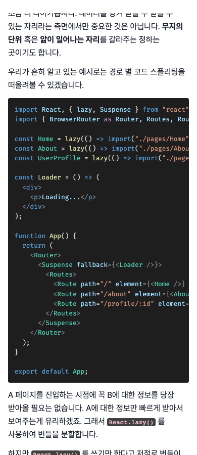

# Fira Code 자체 호스팅·캐시 정책 배포 검증

## 결론

실제 운영 CDN에서 이전 배포와 현재 운영을 교대로 비교했다. 3개 페이지 × 5쌍 = 30회에서 **15쌍 모두 LCP가 단축**됐다. 페이지별 LCP 중앙값은 약 22~26% 줄었다. 운영 6개 화면 비교에서 diff는 모두 0 pixels였으며, 코드 블록의 텍스트·크기·줄바꿈을 유지했다.

이는 아래 제한 조건의 합성 측정 결과다. 실제 사용자 RUM/INP 개선율을 주장하지 않는다.

## 배포

- 폰트 자체 호스팅: [PR #49](https://github.com/saengmotmi/gatsby-starter-lavender/pull/49), merge `b180009b5b7586aa96106ff3779e71380375c0d5`.
- 캐시 규칙 수정: [PR #50](https://github.com/saengmotmi/gatsby-starter-lavender/pull/50), merge `d7a68554ba6820dc1512a43580e63a2a58f2c0b1`.
- 현재 production deploy: `6b09622f4d6e37cb375a4cf7`, `ready`, 게시 시각 2026-11-27T10:58:27.864Z. 측정 전후 모두 published_deploy와 commit 일치.
- 이전 고정 URL: https://6b062ea0074c202c5c9bbf55--saengmotmi.netlify.app
- 현재 운영: https://saengmotmi.netlify.app
- 현재 고정 URL: https://6b09622f4d6e37cb375a4cf7--saengmotmi.netlify.app

## 변경 내용

1. Fira Code v27의 WOFF2 7개 subset을 원본 바이트 그대로 보관하고, 원래 unicode-range·400 굵기·swap을 유지한다. OFL 라이선스와 원본 URL/SHA-256을 함께 포함했다.
2. Prism CSS의 Google Fonts `@import`를 없애고 root에서 로컬 font-face CSS를 번들에 포함한다. 폰트 스택, 코드 스타일, ligature 설정, preload는 변경하지 않았다.
3. Netlify의 `/*` 기본 캐시 정책을 먼저 배치하여 뒤의 개별 정책을 덮지 않도록 수정했다. 두 해결책은 별도 PR로 배포했다.
4. GTM/GA와 Utterances 동작, Pretendard preload는 변경하지 않았다.

## 운영 성능 측정

Chrome 158.0.8127.38, 390×844 DPR1 mobile/touch, CPU 4배 감속. CDP 네트워크: latency 562.5ms, download 180,000B/s, upload 84,375B/s. 매 샘플 새 context 및 HTTP 캐시 비활성화. 페이지별 1회씩 사전 로딩한 6회는 통계에서 제외했다. 페이지 순서를 순환하고 쌍별 before/after 순서를 교대했다.

Google Fonts·GTM/gtag·Utterances는 허용했다. Netlify RUM 및 Google Analytics 수집 endpoint만 CDP로 차단해 합성 측정의 분석 데이터 유입을 막았다. 요청을 대체하는 route interception은 사용하지 않았다. `load + document.fonts.ready + 1000ms` 후 기록했다.

| 페이지 | 이전 LCP 중앙값 | 현재 | 변화 | TTFB 이전 → 현재 |
|---|---:|---:|---:|---:|
| 홈 | 2540ms | 1884ms | -656ms (-25.8%) | 798 → 751ms |
| `/react/what-is-rsc/` | 2780ms | 2108ms | -672ms (-24.2%) | 818 → 771ms |
| `/react/rrv7-static-prerendering/` | 2616ms | 2048ms | -568ms (-21.7%) | 761 → 801ms |

Google Fonts 외부 요청은 이전 15/15회에서 발생했고 현재 0/15회였다. 각 페이지의 `LCP - TTFB` 중앙값도 약 612~620ms 줄었다. prerender 글은 TTFB가 약40ms 늘었는데도 LCP가 단축되어, 결과를 HTML 응답 속도 차이만으로 설명할 수 없다.

페이지별 5쌍의 모든 차이가 음수다. 탐색적 paired bootstrap(10,000 resamples, seed 20261127) 95% 구간은 홈 [-760,-532]ms, RSC [-744,-460]ms, prerender [-732,-524]ms다. 표본 수가 적으므로 이 구간을 실제 사용자 전체나 모든 네트워크의 개선 보장으로 해석하지 않는다.

CLS 중앙값은 각 페이지에서 이전/현재 동일했다(홈 약0.001018, RSC 약0.000075, prerender 약0.000250). 브라우저 앱 오류 및 400 이상인 자사 리소스 응답은 없었다.

### 해석의 한계

- 기존 고정 도메인과 현재 canonical 도메인을 비교했다. CDN 캐시 hit/age·TTFB를 기록했으나 동일 상태로 고정하지 않았다.
- 캐시 정책 수정도 함께 포함하지만, 브라우저 캐시를 껐으므로 1년 브라우저 캐시의 재방문 효과를 이 LCP 개선율로 주장하지 않는다.
- 이전 CSS 순서 실험과 브라우저·네트워크·외부 리소스 조건이 다르다. 이번 before/after끼리만 비교한다.
- INP와 실제 사용자 RUM은 미측정이다. Google Fonts CSS 요청 차단 실험의 27%가 아니라 실제 배포본을 새로 측정한 결과다.

## 운영 캐시 응답 검증

`node scripts/verify-cache-headers.mjs`가 실제 GET으로 확인했다. 6개 URL 모두 HTTP 200.

| 대상 | 이전 | 현재 |
|---|---|---|
| CSS·JS·폰트 | `public,max-age=0,must-revalidate` (기존 CSS·폰트에서 확인) | `public,max-age=31536000,immutable` |
| 홈·글 HTML | 기본 재검증 정책 | `public,max-age=0,must-revalidate` |
| `/sw.js` | catch-all 영향 가능 | `no-cache,no-store,must-revalidate` |

프리뷰와 운영 모두 개별 자산 정책 적용을 확인했다. 현재 응답 원본은 `cache-headers.json`에 있다. 실제 재방문 체감 속도는 별도 측정하지 않았다.

## 화면·기능 검증

- `corepack yarn verify`: 타입 검사·정적 빌드·기존 변환 테스트. 폰트 해시/WOFF2·라이선스·font-face 보존 테스트 2개 추가.
- 각 PR CI verify·Netlify Preview 통과 후 병합.
- 프리뷰 E2E 스크롤 복원/해시 테스트 2개 통과.
- `node experiments/resource-priority/verify-deployment.mjs https://saengmotmi.netlify.app docs/benchmarks/font-delivery/functional.json`: 홈+45개 공개 글 HTTP 200, CSS 우선·font preload 없음, 테마·필터·클라이언트 이동·히스토리 스크롤·해시·한글 경로 통과.
- `AFTER_ORIGIN=https://saengmotmi.netlify.app OUT_DIR=docs/benchmarks/font-delivery/visual node experiments/font-delivery/verify.mjs`: 기존 고정 배포 vs 운영, 홈/코드 글의 390/1280px 및 코드 블록 위치 6개 이미지 diff 모두 0 pixels. 모든 pre geometry 및 텍스트 일치, Fira Code 실제 loaded 확인, 현재 Google Fonts 요청 0건.
- 실제 화면 비교에서는 Google Fonts를 허용해 이전 버전의 폰트를 정상 로드했다. 양쪽 GTM·댓글은 결정적 시각 비교를 위해 차단했다.

| 운영 이전 코드 블록 | 운영 현재 코드 블록 |
|---|---|
|  |  |

## 재현·원본 자료

```sh
node experiments/font-delivery/measure.mjs
OUT_FILE=docs/benchmarks/font-delivery/cache-headers.json node scripts/verify-cache-headers.mjs
AFTER_ORIGIN=https://saengmotmi.netlify.app OUT_DIR=docs/benchmarks/font-delivery/visual node experiments/font-delivery/verify.mjs
```

- `measurements.json`: 30개 sample의 LCP·TTFB·CLS·long task·전체 resource timing·응답별 cache/age/encoding.
- `summary.json`, `paired-summary.json`: 중앙값과 쌍별 차이.
- `deployment.json`, `final-deployment.json`: 측정 전후 게시 상태.
- `functional.json`, `visual/visual-results.json`, `visual/*-diff.png`: 기능/화면 검증.

### Modern Web Guidance

`performance`의 “DON'T use `@import` in CSS”를 적용했다. Fira Code를 제거하는 대신 기존 font-face와 동일한 폰트 파일을 자체 호스팅해 외부 CSS 직렬 요청만 없앴다. preload 권고를 기계적으로 추가하지 않고 실제 배포 반복 측정과 시각회귀로 판단했다.
