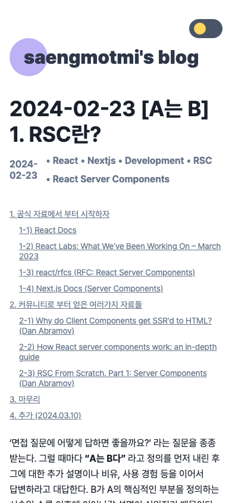

# SSG의 CSS·폰트 요청 우선순위 검증

## 목적과 결론

RSC나 라이브러리 업그레이드 없이 기존 정적 블로그의 첫 화면 표시를 개선한다.

**채택: 생성된 HTML에서 stylesheet를 JS modulepreload 앞으로 이동한다. 폰트 preload는 채택하지 않는다.**

- 정상 동작: 동일한 글·레이아웃·글꼴·JS 상호작용을 유지하면서 정적 파일로 서비스한다.
- 기존 동작: React Router가 초기 HTML에 modulepreload를 먼저, stylesheet를 나중에 출력한다.
- 가설 1: CSS 순서만 바꿔도 스타일 다운로드 완료와 초기 표시가 빨라질 수 있다.
- 가설 2: 필요한 폰트의 preload가 폰트 표시를 앞당길 수 있다.
- 가설 3: 폰트 preload가 CSS/JS와 대역폭을 경쟁해 초기 표시에 손해를 줄 수 있다.

## 결과: LCP 중앙값

LCP는 Largest Contentful Paint, 화면의 주요 콘텐츠가 표시되는 시점이다. 각각 5회 측정했다.

| 페이지 | 기존 | CSS 먼저 | CSS + Bold preload | CSS + 세 폰트 preload |
|---|---:|---:|---:|---:|
| 홈 `/` | 600ms | **544ms (-9.3%)** | 652ms | 660ms |
| `/react/what-is-rsc/` | 752ms | **680ms (-9.6%)** | 788ms | 784ms |
| `/react/rrv7-static-prerendering/` | 680ms | **612ms (-10.0%)** | 708ms | 712ms |

범위(min–max):

| 페이지 | 기존 | CSS 먼저 |
|---|---:|---:|
| 홈 | 564–708ms | 540–552ms |
| RSC 글 | 664–784ms | 648–684ms |
| 사전 렌더링 글 | 628–684ms | 592–632ms |

일부 범위가 겹치므로 모든 접속에서 10% 빨라진다는 뜻은 아니다. 같은 조건의 반복 측정 중앙값에서 개선됐으며 실제 사용자 환경·Netlify CDN에서는 아직 측정하지 않았다.

## 워터폴에서 확인한 첫 차이

**CSS 요청 시작은 거의 같았다. 차이는 주로 CSS 다운로드 완료 시점에서 나타났다.** 단순히 “CSS를 수백 ms 늦게 발견했다”는 설명은 이번 실험에 맞지 않는다.

| 지표 | 기존 | CSS 먼저 |
|---|---:|---:|
| 홈 CSS 완료 | 500.0ms | 440.6ms |
| RSC 글 CSS 완료 | 523.0ms | 461.6ms |
| 사전 렌더링 글 CSS 완료 | 522.5ms | 454.2ms |
| RSC 글 첫 폰트 요청 | 558.7ms | 492.7ms |
| RSC 글 모든 폰트 완료 | 2832.7ms | 2832.9ms |

원시 요청별 시작/완료 시점은 `measurements.json`의 `resources`에 보관했다. CSS 링크 순서 외에 파일·렌더링 코드는 같으므로 이 조작의 LCP 개선 효과를 분리했다. 브라우저 내부 스케줄러의 세부 원리까지 독립적으로 계측한 것은 아니다.

## 폰트 preload를 제외한 이유

- Bold preload는 RSC 글의 폰트 요청을 약 559 → 60ms로 앞당겼다.
- Bold 다운로드 완료도 2833 → 2570ms로 당겨졌지만, LCP는 752 → 788ms로 나빠졌다.
- 세 폰트 preload는 사전 렌더링 글의 모든 폰트 완료를 3793 → 3380ms로 당겼다. 대신 LCP는 680 → 712ms로 나빠졌다.
- 따라서 폰트 preload가 항상 나쁘다는 결론은 아니다. **이번 블로그의 첫 화면 LCP를 개선하면서 동작을 유지하는 목적에는 CSS 순서만 바꾸는 안이 더 적합했다.**
- 실제로 내려받은 폰트 요청은 모든 표본에서 3개였다. 중복 폰트 요청은 관측되지 않았다. 현지 설치 폰트가 있는 사용자에게 preload가 불필요한 다운로드를 일으키는 경우는 별도 검증하지 않았다.

## 유지한 것

- React Router **7.13.0**, React **19.2.4**, Vite **6.4.1**. 의존성·lockfile 변경 없음.
- `ssr: false`와 사전 렌더링, `cssCodeSplit: false` 유지.
- 모든 그룹의 실제 JS 압축 전송량 **109,964 B (107.4 KiB)**로 동일. 기존 viewport prefetch 포함.
- 최종 빌드의 JS/CSS/폰트/이미지 등 assets **73개 SHA-256 동일**.
- 본문, stylesheet 간 순서, 나머지 태그를 유지한다. 빌드 산출물의 head 안에서 stylesheet 위치만 바꾼다.
- 대표 페이지 CLS 중앙값 동일: 홈 0.000611, RSC 글 0.005397, 사전 렌더링 글 0.002358.
- 전체 전송 본문 크기는 gzip의 순서 효과로 1~2바이트만 감소했다. 번들 크기 최적화가 아니다.

## 코드 변경

- `scripts/prioritize-stylesheets.mjs`: 사전 렌더링 HTML을 후처리한다. 47개 HTML(공개 글 45편 + 홈 + SPA fallback)에 적용한다. 다시 실행해도 결과가 같은 변환이다. stylesheet/modulepreload가 없는 head는 그대로 둔다.
- `package.json`: `build` 마지막에 후처리를 실행한다. `verify`는 타입 검사·동일 build·HTML 변환 테스트를 실행한다.
- `experiments/resource-priority/`: 실험용 정적 서버, 네 가지 head 변환, 측정·기능·시각 검증 스크립트. 런타임 번들에는 들어가지 않는다.

직접 `<Links />` 내부 구현에 의존하거나 프레임워크를 패치하지 않는다. 빌드 시 정적 결과물만 다룬다. 이후 React Router가 head 출력 형식을 바꾸면 테스트·실제 HTML 순서를 다시 확인해야 한다. 개발 서버에는 후처리가 적용되지 않는다.

## 검증 근거

실험 기준: main `564e28a315c80386f80ddc4c310117c7f307b818`.

- 동일한 한 번의 raw 빌드에서 HTML head만 달리 제공했다. 그룹 간 assets는 동일 파일을 읽는다.
- Chromium 145.0.7632.6, viewport 390×844, DPR 1.
- CPU 4배 감속, 다운로드 200,000 B/s(1.6 Mbps), 업로드 100,000 B/s, 지연 40ms.
- gzip level 6. 각 표본은 새로운 browser context. 외부 GTM/댓글 요청 차단.
- 4개 그룹 × 3개 URL × 5회 = **60개 표본**, 그룹 순서 회전.
- load + document.fonts.ready + 500ms까지 관측했다. 따라서 폰트 교체 이후 CLS도 포함한다.
- 모든 표본에서 pageerror/로컬 HTTP 오류 0건.
- 테마, Article/Fleeting, SPA 글 이동, 뒤로/앞으로 스크롤 복원, 해시, 한글 URL 통과.
- 홈/RSC 글/목수의 삶의 390×844·1280×900 캡처에서 baseline 대비 모든 후보의 픽셀 차이 **0개**. 채널 차이 >10을 변경 픽셀로 계산한다. 본문 텍스트·제목 크기·폰트 로딩 상태도 확인했다.
- 최종 build 출력 HTML 47개는 실제 측정한 CSS-first 변환 결과와 SHA-256이 모두 동일하다. 실험 서버에서만 빨라지는 후보를 보고한 것이 아니다.
- `yarn verify`, `yarn install --immutable`, `git diff --check` 통과. HTML 변환 테스트 **7개 통과**.

로컬 실험실 결과다. 실제 CDN/사용자 성능, INP, 모든 페이지 full-page 시각 회귀는 미검증이다. 운영에는 배포하지 않았다.

### 화면 증거

캡처 URL: baseline `http://127.0.0.1:4321/react/what-is-rsc/`, CSS-first `http://127.0.0.1:4322/react/what-is-rsc/`.

| 이전 | CSS 먼저 |
|---|---|
|  |  |


## 재현

worktree: `~/worktrees/gatsby-starter-lavender/codex-ssg-resource-priority`.
브랜치: `codex/ssg-resource-priority`.

실험 시 **후처리 전 raw 빌드**를 만들어야 한다. `yarn build`는 이미 개선을 적용하므로 그대로 baseline으로 쓰면 안 된다. 실험 서버는 이를 감지해 거부한다.

```bash
corepack yarn install --immutable
corepack yarn generate:content
corepack yarn react-router build
node experiments/resource-priority/serve.mjs
```

서버는 4321~4324에서 동일한 assets와 네 가지 head를 제공한다. 다른 터미널에서, 측정과 브라우저 검증을 병렬로 실행하지 않는다.

```bash
node --test experiments/resource-priority/html-variants.test.mjs
node experiments/resource-priority/measure.mjs
node experiments/resource-priority/summarize.mjs
node experiments/resource-priority/verify.mjs
```

측정 종료 후 최종 산출물을 만든다.

```bash
corepack yarn verify
corepack yarn install --immutable
git diff --check
```

주의: `verify`는 build/client를 최종 CSS-first 결과로 교체한다. 기존 실험 서버를 계속 열어 두고 재측정하지 않는다. 다시 비교하려면 서버를 종료하고 raw 빌드부터 시작한다.

원시 결과: `measurements.json`, `summary.json`, `verification.json`.
최종 산출물 동일성: `assets-before.json`, `expected-html.json`, `build-equivalence.json`.
검증 로그: `verify.log`, `install.log`, `functional-visual.log`.
