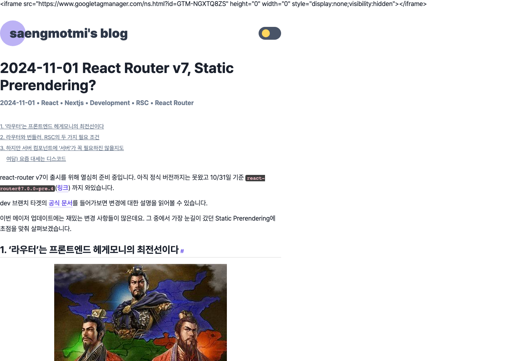
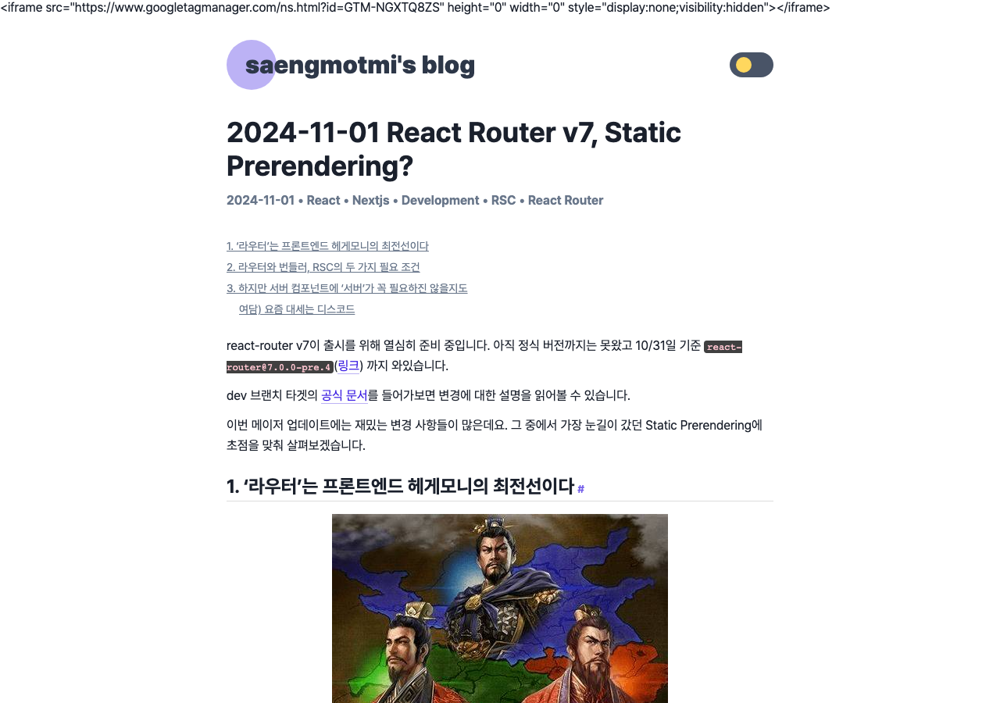

# Fira Code 외부 CSS 대기 제거

## 목적과 변경

코드 블록이 없는 홈까지 막던 Google Fonts CSS `@import` 직렬 요청을 없앤다. Fira Code v27 WOFF2 7개 subset을 원본 바이트 그대로 자체 호스팅하며 굵기 400, unicode-range, swap과 폰트 스택을 유지한다. OFL 라이선스와 원본 URL/SHA-256을 함께 보관한다. preload, GTM/GA, 캐시 정책은 이 PR에서 변경하지 않는다.

## 검증

- `corepack yarn verify`: 타입 검사·빌드·기존 HTML 변환 테스트 통과. 새 `font-assets.test.mjs` 2개 추가 통과.
- `corepack yarn playwright test --config experiments/font-delivery/playwright.config.ts`: 빌드 결과 서버(4178)에서 기존 E2E 2개 통과.
- 기본 E2E 명령의 첫 시도는 기존 프로세스가 점유한 4173 서버를 재사용해 실패했다. 해당 프로세스는 종료하지 않고 독립 빌드 서버에서 다시 검증했다.
- `node experiments/font-delivery/verify.mjs`: 기존 고정 배포 vs 로컬 빌드, 홈/코드 글, 390/1280px, 첫 화면 및 코드 블록 총 6개 화면 **diff 0 pixels**. 모든 pre의 텍스트·폭·높이·scrollWidth·fontFamily 일치. 코드 페이지에서 Fira Code 실제 loaded 확인. 변경본의 Google Fonts 요청 0건.
- PR 스크린샷: `ALLOW_WEB_FONTS=1 corepack yarn modern-screenshot <URL> <PNG>`.
- 이전 URL: https://6b062ea0074c202c5c9bbf55--saengmotmi.netlify.app/react/rrv7-static-prerendering/
- 변경본 URL: http://127.0.0.1:4178/react/rrv7-static-prerendering/
- `visual-results.json`, `*-metrics.json`, `*-diff.png`에 원본 검증 결과 보관.

| 이전 | 변경본 |
|---|---|
|  |  |

## 판단

폰트 외형과 코드 블록 geometry를 유지하고 외부 CSS 요청을 제거했다. 실제 운영 LCP 효과는 배포 전후 동일 조건 반복 측정으로 별도 확인한다. 기존 요청 차단 실험의 약27%를 이 구현의 개선율로 간주하지 않는다.

Modern Web Guidance `performance`: “DON'T use `@import` in CSS”를 적용했다. `font-display: swap`만으로 외부 CSS의 렌더 차단을 없앨 수 없으므로 font-face 선언을 로컬 번들에 포함했다.
